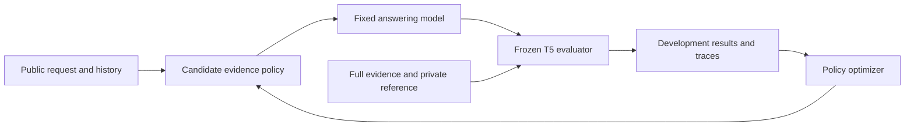

# Applying Meta-Harness to PersonaBench T5

**Recommendation: adopt the optimization method around a separate answering
policy, with a fixed and independently validated evaluator.** The immediate
opportunity is evidence selection and presentation. Automated case acceptance or
scoring changes should not be rewarded by higher answerer scores.

Reading scope: all 26 pages of arXiv:2603.28052v1, including the figures and
appendices; the released reference implementation; the TerminalBench artifact;
and the current local T5 implementation. This document proposes a next experiment.
It does not change the frozen 0.4 protocol or report a new performance result.
The subsequent implementation and controlled comparison are recorded in
[POLICY_EXPERIMENT.md](POLICY_EXPERIMENT.md).

**What the paper establishes**

Meta-Harness searches executable harness code around fixed models. A proposer
selectively reads previous code, scores, and traces from a filesystem; an external
evaluator runs candidates. Table 3 supports trace access over compressed feedback
in classification. Classification improves from 40.9% to 48.6%; math improves
1.3 points over BM25. TerminalBench searches and evaluates on the same 89 tasks.
Section 4.2 includes the search model among five evaluated models, so four are
unseen. Appendices A–B describe failed interventions, counterexample-guided
retrieval, and an environment snapshot; Appendix D recommends interface checks
and evaluation outside the proposer. These are reported results, not PersonaBench
results. [Paper, Sections 3–4 and Appendices A–D](https://arxiv.org/pdf/2603.28052).

My interpretation: detailed traces make a failed trial useful for deciding what
to test next. That supports a research workflow; it does not make an inferred
cause certain. A change still needs controlled comparison. A gain on a repeatedly
queried benchmark also answers a different question from a gain on fresh people
and scenarios. For our use case, the latter is the claim worth pursuing.

**The three components we should distinguish**

| Component | Responsibility | Allowed to change during search? |
|---|---|---|
| T5 evaluator | Cases, reference requirements, judging, aggregation, and validity checks | No |
| Answering policy | How public history is retrieved, organized, and presented to a fixed model | Yes, within the registered interface |
| Search controller | Proposes policies and inspects development experiments | Yes between registered studies; its budget and settings are recorded |

The development loop would be:



Final-test cases and feedback remain outside this loop.

Our current [answering path](experiment.py) serializes one public episode into one
model call. It is a useful baseline, but does not yet expose interchangeable
context-selection implementations. The existing [protocol](protocol.py),
[transport](backend.py), [artifact audit](audit_artifacts.py), and
[human-reference comparison](human_report.py) provide much of the evaluation
infrastructure needed to assess candidates.

The objective for an answering policy is improved justified help under the same
requirements. The objective for the evaluator is agreement with independently
adjudicated human judgments. The objective for case generation is valid evidence
and representative coverage. These need separate experiments and acceptance
criteria. If a judge rewards a mistake, automated search can learn to produce
that mistake more consistently.

**Where the current evidence points**

In our frozen 0.3 development experiment, Haiku scored 8/18 with compact full history
and 14/18 with privileged relevant excerpts. This motivates testing context
selection. It does not establish that any deployable retriever achieves that gain:
the excerpt selector reads private contract evidence IDs. Explicit-fact context
also comes from the private contract. Both remain diagnostic conditions.

Only 8/24 proposed families passed the admission screen, and some review judgments
were themselves defective. Improving data quality and reference validity is
therefore at least as important as improving the answering policy. Our six fresh
0.4 controls were saturated by both tested models; they are useful regressions,
but offer little signal for optimizing performance. These observations and their
limits are recorded in [FOLLOWUP.md](FOLLOWUP.md).

**A concrete first experiment**

Start with a narrow interface that selects source spans from public logs:

```python
select_context(public_episode, budget) -> selected_source_spans
```

The trusted runner renders those spans with their original speakers, timestamps,
and identifiers. It always includes the current request, clock, task state, and
capability policy. The candidate cannot change those fields or the scoring rules.
Begin with three policies: full history, lexical retrieval, and lexical retrieval
augmented with entity links and temporal updates. Use the same answering prompt,
model, generation budget, cases, and judge across them.

The third policy should retrieve surrounding updates and contradictions. A request
about a meeting needs both its original time and any rescheduling or cancellation.
A message-sharing request may require who owns the information, who the recipient
is, and the scope of any permission. Recency alone is insufficient: an older
standing instruction can remain applicable. Retrieved text must retain uncertainty
and subject identity; extracting a personal preference must not turn it into a ban.

**Judge every candidate against the original complete public episode and its
frozen requirements.** A candidate that drops decisive evidence has failed to
retrieve it. It does not earn the easier no-history rubric. The model sees the
candidate's context; the evaluator sees the complete reference context.

Add generated summaries only after establishing extraction baselines. Require
source-span provenance for each summary claim, and count their generation and
verification costs. A later two-call experiment can draft an answer, search the
public history for contradicting evidence, and revise. Include a matched two-call
control with generic revision so extra inference is not mistaken for a retrieval
improvement. Do not expose target action labels, private contracts, or other family
variants as runtime examples.

**Logging that would make search informative**

Extend the existing immutable run layout with a candidate code snapshot, parent
candidate, dependencies, stated hypothesis, selected and omitted evidence, exact
prompts, observable intermediate outputs, final response, judge observations,
tokens, latency, and transport errors. Private chain-of-thought is not required.

A small comparison command should answer: which cases changed, which requirement
changed status, whether the selected evidence changed, and how cost changed.
Retain unsuccessful candidates. Summary tables can help navigation, while the
underlying records remain available for diagnosis. Failure categories should be
tentative annotations: evidence not retrieved, evidence misinterpreted, invalid
case requirement, judge disagreement, and execution/transport failure require
different remedies.

Candidate manifests need policy source and dependency hashes in addition to the
current six-file core freeze. A model-call cache may reuse identical prompts;
shared cached answers are not independent replications. A new replicate ID must
request a new draw, as it does today.

**What to take from the released code**

The reference implementation separates proposal, import validation, benchmarking,
and finalization. Its memory interface predicts before receiving labeled feedback;
the shipped configuration uses offline learning. That label-learning assumption
does not belong in our independent T5 runtime episodes. Borrow the interface and
logging pattern, with a fresh per-episode state and no reference-answer feedback.
[Reference loop](https://github.com/stanford-iris-lab/meta-harness/blob/0cbc31e97c9e6d24232d1dc754827c02e1ec415c/reference_examples/text_classification/meta_harness.py),
[memory interface](https://github.com/stanford-iris-lab/meta-harness/blob/0cbc31e97c9e6d24232d1dc754827c02e1ec415c/reference_examples/text_classification/memory_system.py),
[configuration](https://github.com/stanford-iris-lab/meta-harness/blob/0cbc31e97c9e6d24232d1dc754827c02e1ec415c/reference_examples/text_classification/config.yaml).

The separate coding artifact gathers environment information before the agent
loop. For T5, a useful analogous input is an accurate task-state description.
We already provide a request clock and capabilities; adding operating-system
discovery commands would not help this response-only track.
[Artifact implementation](https://github.com/stanford-iris-lab/meta-harness-tbench2-artifact/blob/57fefdb2ff84af3fd81b69d67814acbe69bd0743/agent.py).

The reference loop blocks further evolution after completed finalization; incomplete
finalization remains resumable. Our rule should be stronger: once any final-test
feedback is visible, those cases are consumed for future design decisions, even
if the job fails. Technical recovery may finish the same frozen evaluation, but
cannot reopen candidate selection. The released repository also describes itself
as cleaned-up reference code with limited testing; integration needs local checks.
[Finalization code](https://github.com/stanford-iris-lab/meta-harness/blob/0cbc31e97c9e6d24232d1dc754827c02e1ec415c/reference_examples/text_classification/meta_harness.py#L286),
[release note](https://github.com/stanford-iris-lab/meta-harness/blob/0cbc31e97c9e6d24232d1dc754827c02e1ec415c/README.md).

**Conditions for a credible improvement claim**

1. Establish case validity and judge calibration against independent human
   references. Keep the case inventory fixed during answering-policy search.
2. Use development feedback for optimization. Reserve fresh personas and scenario
   families for final testing. Previously inspected held-out runs are development
   evidence for future changes. Keep whole families together across splits.
3. Give the proposer only authorized development artifacts. Run candidate code in
   a separate environment containing public episode data, with model access through
   a budgeted broker. A prompt telling code not to read private files is insufficient.
4. Register the search budget, candidate-selection rule, model settings, and
   comparison metrics. Repeated selection on noisy scores can favor lucky or
   judge-exploiting candidates. Re-evaluate finalists with fresh draws and retain
   persona-cluster uncertainty.
5. Report complete-family and case success, critical violations, unnecessary
   intervention, unresolved evaluations, and total cost. Cost includes retrieval,
   summarization, additional model calls, and optimization itself. Reduced context
   in the final answer call does not automatically mean a cheaper system.
6. Confirm performance on new personas and a second answering model. Keep the
   existing full-history baseline visible. Report model-plus-policy performance;
   unequal per-model search budgets do not support an intrinsic model ranking.

For a direct test of the search method, compare access to scalar results,
results plus concise summaries, and results plus full development traces using
matched proposer settings and evaluation budgets. Separately record proposer
compute, since equal evaluation counts do not guarantee equal total cost. Do not
change retrieval and answering prompts together in the first ablation.

**Priority and unresolved decisions**

First finish the human reference work and add the candidate interface and comparison
artifacts. Then run the three fixed context policies before introducing automatic
code search. Expand to multi-call answering only if retrieval experiments reveal
a residual reasoning or verification gap. Leave case-generation optimization for
a separate study with independently measured validity and coverage.

The candidate count, cost ceiling, independent-persona sample size, and acceptable
judge-error budget are not set by this analysis. They must be registered before
running an optimization study. The existing CLI transport also leaves some
decoding settings unavailable; retain that limitation or select a transport that
exposes the settings required by the study.

This design would let PersonaBench answer an additional useful question: **how
much does better handling of the same personal evidence improve justified help?**
It preserves the benchmark's role in measuring that improvement independently.
